<a href="https://manish-devfolio.vercel.app/"></a>

<a href="https://manish-devfolio.vercel.app/">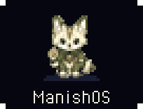</a>
<a href="https://www.linkedin.com/in/manishghoshal99/">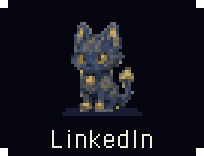</a>
<a href="https://medium.com/@manishghoshal99.py">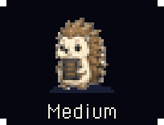</a>
<a href="mailto:manishghoshal99.py@gmail.com">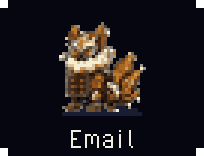</a>

Hi, I'm Manish. I'm finishing a Master of Data Science at the University of Melbourne after building ML products at startups in Bengaluru, and I'm open to data science and ML engineering internships and graduate roles. I like problems where the model is the easy part: noise on a consumer heart monitor, names in coronial records, a hospital ward four hours from now. Most of that work is measurement.

Before you scroll on, my koi is hungry.

<a href="https://github.com/manishghoshal99/manishghoshal99/issues/new?title=koi%3A%20feed&body=Submit%20this%20issue%20and%20the%20koi%20will%20reply%20here%20in%20a%20minute%20or%20two.%20You%20do%20not%20need%20to%20write%20anything."></a>
<a href="https://github.com/manishghoshal99/manishghoshal99/issues?q=is%3Aissue%20koi">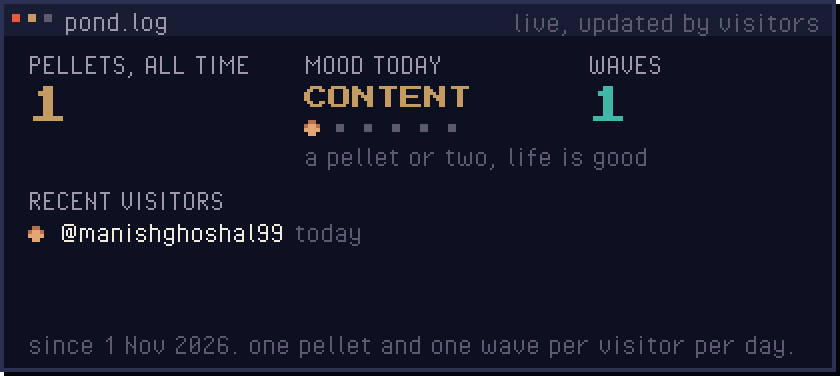</a>

Each button opens a ready-made issue. Submit it and a GitHub Action feeds the koi, adds you to the pond log and replies, usually within a minute or two. One pellet and one wave per visitor per day. The koi itself is redrawn every night by <a href="https://github.com/yalongwastaken/git-koi">git-koi</a> from my public activity.

<a href="https://wardsignal.vercel.app/">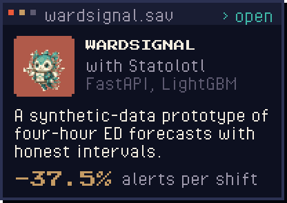</a>
<a href="https://github.com/manishghoshal99/nebula">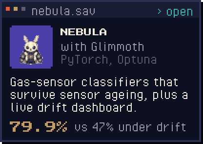</a>
<a href="https://github.com/manishghoshal99/AgriLens.AI">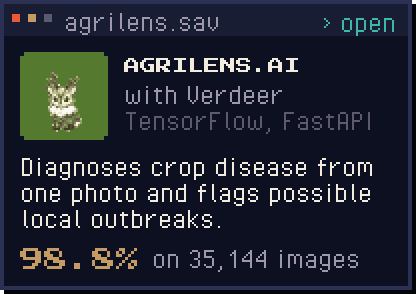</a>
<a href="https://github.com/manishghoshal99/Redmane_Metadata_RO_Crate">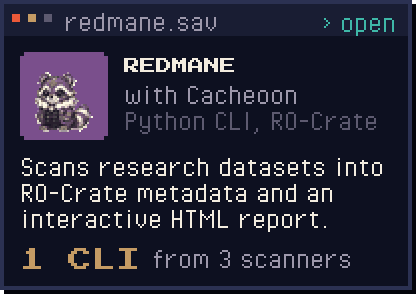</a>

Live demos: <a href="https://wardsignal.vercel.app/">WardSignal</a> · <a href="https://nebula-web-app-gray.vercel.app/">Nebula</a> · <a href="https://agri-lens-ai.vercel.app">AgriLens.AI</a>. The creatures are Bytekin from MG Quest, the game on my portfolio.


<code>~$ cat recent_work.txt</code>

- **Biosignals Diagnostics**, data scientist, April to October 2026. Led a team of five on the noise-detection layer of a consumer heart monitor. Scoring every five-second window instead of each recording whole took mixed-noise detection from 2 of 20 recordings to 20 of 20.
- **Melbourne Data Analytics Platform, University of Melbourne**, data scientist, July to October 2026. NLP that de-identifies coronial records. I rebuilt the evaluation on the published metrics and built a three-stage resolver that tripled correct person links with zero false links, without a language model.
- **Walter and Eliza Hall Institute (WEHI)**, research data engineering intern, November 2025 to March 2026. Turned a brittle metadata script into an installable CLI that scans research datasets into RO-Crate JSON and interactive HTML summaries.

<code>~$ ls writing/</code>

- [The forecast is just the easy part](https://medium.com/@manishghoshal99.py/the-forecast-is-just-the-easy-part-11e94d6c852e), August 2026. What WardSignal's benchmark proved, and what it did not.
- [Your guide to context engineering](https://medium.com/@manishghoshal99.py/your-guide-to-context-engineering-the-four-pillar-blueprint-replacing-prompt-engineering-for-6c1dc4ed8fba), July 2025. The four-pillar blueprint replacing prompt engineering.
- [Breaking down data: all about chunking](https://medium.com/@manishghoshal99.py/breaking-down-data-all-about-chunking-48911f015dfe), August 2024. Chunking strategies for retrieval.
- [Optimizing Llama 3 8B for edge devices](https://medium.com/@manishghoshal99.py/optimizing-llama-3-8b-for-edge-devices-a-breakthrough-fine-tuning-process-4d12266cc772), June 2024. A QLoRA fine-tuning process that fits a small GPU.

<code>~$ cat stack.txt</code>

**Languages** · Python, R, SQL, TypeScript, Bash 
**Modelling** · PyTorch, TensorFlow, scikit-learn, LightGBM, Transformers, conformal prediction, SHAP 
**NLP and LLMs** · spaCy, Flair, Presidio, LangChain, LangGraph, retrieval with BM25, Qdrant and cross-encoders, QLoRA 
**Data and MLOps** · PostgreSQL, Spark, Elasticsearch, FastAPI, Docker, Kubernetes, GitHub Actions, MLflow, Airflow, AWS 
**Daily tools** · Claude Code and Cursor, with my own hooks and MCP servers

<code>~$ cat elsewhere.txt</code>

I was a section leader for Stanford's Code in Place, teaching Python to beginners. I build pixel-art things for [ManishOS](https://manish-devfolio.vercel.app/), a desktop-OS portfolio with a playable overworld résumé, which is where every creature on this page comes from. Bengali is my first language; Hindi and English are the others.

<a href="https://manish-devfolio.vercel.app/">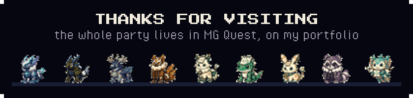</a>

Melbourne, Victoria · <a href="mailto:manishghoshal99.py@gmail.com">manishghoshal99.py@gmail.com</a> · art and fonts credited in <a href="ASSETS.md">ASSETS.md</a>

