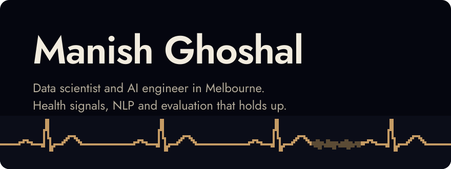

  

I'm finishing a Master of Data Science at the University of Melbourne (Computational Data Science, graduating August 2027), after building ML products at startups in Bengaluru.

The problems I like are the ones where the model is the easy part: noise on a consumer heart monitor, names in coronial records, a hospital ward four hours from now. Most of the work turns out to be measurement, and that is where a model earns its trust or loses it. I'm open to data science and ML engineering internships and graduate roles.

[LinkedIn](https://www.linkedin.com/in/manishghoshal99/) · [ManishOS, my portfolio](https://manish-devfolio.vercel.app/) · [Medium](https://medium.com/@manishghoshal99.py) · [manishghoshal99.py@gmail.com](mailto:manishghoshal99.py@gmail.com)

  

Redrawn every night by <a href="https://github.com/yalongwastaken/git-koi">git-koi</a> from my public activity: languages colour it, contributions grow it, streaks mark it, and the day that just ended decides how it swims.

## Recently

**Biosignals Diagnostics**, data scientist, April to October 2026. Led a team of five on the noise-detection layer of a consumer heart monitor. Scoring every five-second window instead of each recording whole took mixed-noise detection from 2 of 20 recordings to 20 of 20.

**Melbourne Data Analytics Platform, University of Melbourne**, data scientist, July to October 2026. NLP that de-identifies coronial records. I rebuilt the evaluation on the published metrics and built a three-stage resolver that tripled correct person links with zero false links, without a language model.

**Walter and Eliza Hall Institute (WEHI)**, research data engineering intern, November 2025 to March 2026. Turned a brittle metadata script into an installable CLI that scans research datasets into RO-Crate JSON and interactive HTML summaries.

## Selected work

**[WardSignal](https://wardsignal.vercel.app/)** · forecasting and governed alerting for hospital operations 
Four-hour forecasts of emergency-department demand and bed pressure, with conformal intervals banded into operational plays, SHAP drivers, a hash-chained audit log and a model card generated from the running config. A prototype on synthetic data: it cut alert load by 37.5% while keeping 195 minutes of mean warning. FastAPI, LightGBM, React. [The write-up](https://medium.com/@manishghoshal99.py/the-forecast-is-just-the-easy-part-11e94d6c852e) is candid about what the benchmark did not prove.

**[Nebula](https://github.com/manishghoshal99/nebula)** · gas-sensor classification under distribution shift ([live](https://nebula-web-app-gray.vercel.app/)) 
Drift-robust classifiers with CORAL domain adaptation and residualisation: 79.9% accuracy under temporal drift against a 47% baseline, and 83.5% under concentration shift against 50%. Models in PyTorch with Optuna; dashboard in React and Vite.

**[AgriLens.AI](https://github.com/manishghoshal99/AgriLens.AI)** · crop-disease diagnosis from a photo ([live](https://agri-lens-ai.vercel.app)) 
InceptionV3 fine-tuned on a 141k-image augmented set: 98.8% accuracy on 35,144 held-out images across 38 classes, served behind a FastAPI and React app that returns treatment guidance and uses the photo's location to flag a possible local outbreak.

**[REDMANE metadata generator](https://github.com/manishghoshal99/Redmane_Metadata_RO_Crate)** · RO-Crate metadata for research datasets 
The public counterpart of the WEHI work: recursive scanning of sequencing and imaging data, a configurable schema, and RO-Crate JSON with an interactive HTML report.

## Competitions

- 11th at Algothon 2026, the Susquehanna (SIG) algorithmic trading competition in Australia
- 235th of 4,018 teams at IMC Prosperity 2026
- Top 15 of 1,500+ participants at the Amazon ML Challenge 2023

## Writing

- [The forecast is just the easy part](https://medium.com/@manishghoshal99.py/the-forecast-is-just-the-easy-part-11e94d6c852e), August 2026. What WardSignal's benchmark proved, and what it did not.
- [Your guide to context engineering](https://medium.com/@manishghoshal99.py/your-guide-to-context-engineering-the-four-pillar-blueprint-replacing-prompt-engineering-for-6c1dc4ed8fba), July 2025. The four-pillar blueprint replacing prompt engineering.
- [Breaking down data: all about chunking](https://medium.com/@manishghoshal99.py/breaking-down-data-all-about-chunking-48911f015dfe), August 2024. Chunking strategies for retrieval.
- [Optimizing Llama 3 8B for edge devices](https://medium.com/@manishghoshal99.py/optimizing-llama-3-8b-for-edge-devices-a-breakthrough-fine-tuning-process-4d12266cc772), June 2024. A QLoRA fine-tuning process that fits a small GPU.

## Stack

**Languages** · Python, R, SQL, TypeScript, Bash 
**Modelling** · PyTorch, TensorFlow, scikit-learn, LightGBM, Transformers, conformal prediction, SHAP 
**NLP and LLMs** · spaCy, Flair, Presidio, LangChain, LangGraph, retrieval with BM25, Qdrant and cross-encoders, QLoRA 
**Data and MLOps** · PostgreSQL, Spark, Elasticsearch, FastAPI, Docker, Kubernetes, GitHub Actions, MLflow, Airflow, AWS 
**Daily tools** · Claude Code and Cursor, with my own hooks and MCP servers

## Elsewhere

I was a section leader for Stanford's Code in Place, teaching Python to beginners, and I build pixel-art things for [ManishOS](https://manish-devfolio.vercel.app/), a desktop-OS portfolio with a playable overworld résumé. Bengali is my first language; Hindi and English are the others.

Melbourne, Victoria · <a href="https://www.linkedin.com/in/manishghoshal99/">LinkedIn</a> · <a href="https://manish-devfolio.vercel.app/">ManishOS</a> · <a href="https://medium.com/@manishghoshal99.py">Medium</a>

